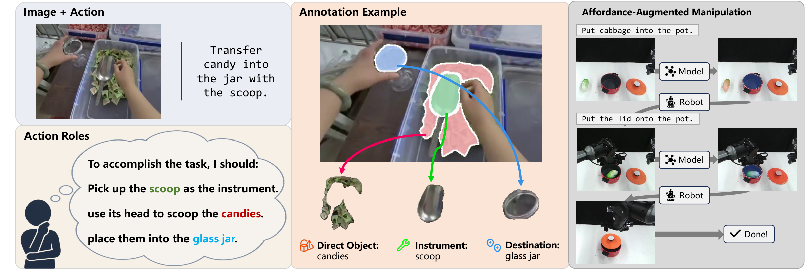

<div align="center">

<h1> EgoAfford · Sa2VA</h1>

### EgoAfford: A Dataset and Benchmark for Role-Structured Egocentric Affordance Grounding

Xinyuan Guan, Feifan Chen, Xinyu Zhan, Fu-Cheng Zhang, Cewu Lu, Lixin Yang

Shanghai Jiao Tong University · Shanghai Innovation Institute · Noematrix Ltd

[](https://egoafford.github.io/)
[](https://arxiv.org/abs/2608.04533)
[](https://github.com/Pandenotium/EgoAfford-Sa2VA-finetuned)

</div>

<p align="center"></p>

## Overview

Given a current egocentric image and an action, **EgoAfford** grounds the action-relevant regions of three roles in a fixed order:

- **Direct object:** the object being manipulated.
- **Instrument:** the held tool used to perform the action; bare hands are not instruments.
- **Destination:** the receiving object or region in a transfer action.

Absent roles have empty masks. This repository contains the EgoAfford adaptation of **Sa2VA-8B**, together with training, single-image/batch inference, visualization and evaluation tools. The model combines InternVL3-8B with SAM2 Hiera-L and predicts all three masks in one forward pass.

## Release status

This is a **private code review snapshot**. The implementation comes from the paper's final training source. The environment and model configuration have CPU checks; a fresh-checkout GPU inference check is still needed before public release. Checkpoints and input data are supplied separately. Links to the paper and project page may still show the previous release.

## Installation

The source environment uses Linux, Python **3.12**, PyTorch **2.6.0+cu124**, Transformers **4.57.1**, and FlashAttention **2.7.0.post2**. Training and inference require an NVIDIA GPU; FlashAttention installation also requires a compatible CUDA toolchain.

```bash
conda create -n egoafford-sa2va python=3.12 -y
conda activate egoafford-sa2va
python -m pip install --upgrade pip wheel packaging ninja
python -m pip install torch==2.6.0 torchvision==0.21.0 \
  --index-url https://download.pytorch.org/whl/cu124
python -m pip install -r requirements-sa2va.txt
python -m pip install flash-attn==2.7.0.post2 --no-build-isolation
python -m pip install -e .
```

A focused Sa2VA source snapshot is included under `third_party/sa2va/`. Its recorded upstream revision is `b6fed1a7928ad4adfa124f1fe79031c1f58ec7a1`. Model loading uses the InternVL model's custom Python code; obtain pretrained components from the original providers and review their code and licenses.

## Configuration

Run the commands below from the repository root. Edit [`configs/sa2va_8b.json`](configs/sa2va_8b.json) to point to your local files. Config paths resolve relative to this repository; absolute paths and environment variables are also supported.

```text
pretrained/
  InternVL3-8B/                 # Original OpenGVLab/InternVL3-8B files
  sam2_hiera_large.pt           # Original SAM2 Hiera-L checkpoint
  egoafford_sa2va_epoch18.pth    # EgoAfford trained state, provided separately
data/
  manifests/
    train.jsonl
    real_val.jsonl
    real_test.jsonl
    synthetic_test.jsonl
```

Original component sources: [InternVL3-8B](https://huggingface.co/OpenGVLab/InternVL3-8B), [SAM2](https://github.com/facebookresearch/sam2), and [Sa2VA](https://github.com/bytedance/Sa2VA).

For portable manifests, set `EGOAFFORD_DATA_ROOT` to the directory containing the image and mask paths. Without it, paths resolve relative to the manifest's directory. Training accepts the original packed-NPZ interface and explicit binary PNG masks; see [the native training format](docs/SA2VA_DATA.md). The [benchmark interface](docs/DATA_FORMAT.md) describes the PNG evaluation format.

```bash
export EGOAFFORD_DATA_ROOT=/absolute/path/to/egoafford
python scripts/check_config.py --check-files --runtime-imports
```

## Inference

### One image

```bash
python scripts/predict.py --config configs/sa2va_8b.json \
  --checkpoint pretrained/egoafford_sa2va_epoch18.pth \
  --image example.jpg --action "Move the cup onto the tray" \
  --output outputs/example --trusted-checkpoint
```

The result contains three binary PNG masks, `predictions.jsonl`, and `records.jsonl` with generated text and format diagnostics. Prediction paths are relative to the output directory. Role mapping follows the generated role lines and segmentation tokens, without consulting GT.

`--trusted-checkpoint` permits pickle loading of the original MMEngine checkpoint. Use it only with a checkpoint you trust. For a tensor-only checkpoint, omit this flag. The loader checks that trained parameters are present while allowing frozen parameters to come from the pretrained components.

### A manifest

```bash
python scripts/predict.py --config configs/sa2va_8b.json \
  --checkpoint pretrained/egoafford_sa2va_epoch18.pth \
  --manifest data/manifests/real_test.jsonl --batch-size 1 \
  --output outputs/real_test --evaluate --trusted-checkpoint
```

`--evaluate` also writes `metrics.json` using the native paper evaluator. It requires GT masks. Batch size 1 is a conservative starting point; the paper's batched path is retained and can use a larger batch when GPU memory allows. Choose a new output directory for each run.

## Training

The reference recipe uses pretrained **InternVL3-8B and SAM2 components** for initialization. It uses full-rule prompting, role names and boxes, and one segmentation token per role, including absent roles (`emit_empty`). The LLM uses LoRA rank/alpha/dropout **128/256/0.05**; token embeddings, the language head, SEG projector and SAM2 mask decoder are trained. Vision encoders and the SAM2 prompt encoder are frozen.

```bash
NPROC_PER_NODE=8 bash scripts/train.sh configs/sa2va_8b.json
```

The paper recipe uses 40 epochs, LR `4e-5`, 5% warmup with cosine decay, seed 42, and an effective global batch of 32. With eight GPUs and micro-batch 2, gradient accumulation is 2. The launcher also accepts `EGO_MICRO_BATCH`; the effective batch must divide evenly by world size × micro-batch. This launcher is for a single node.

Checkpoints are written under the config's `run` directory. The original run selected **epoch 18** by cIoU on the 778-image real validation set. To evaluate a checkpoint, pass its path to `scripts/predict.py`; this repository does not automatically select a checkpoint from test scores.

## Evaluation and visualization

Scores are fractions; multiply by 100 for paper percentages. **cIoU** aggregates intersections and unions across samples and roles. **gIoU** averages per-mask IoU, including empty–empty pairs as 1. **NE-mIoU** averages IoU for each role over samples where its GT mask is non-empty. **Presence-F1** measures whether a role mask is non-empty.

For PNG manifests and predictions:

```bash
python -m egoafford evaluate --ground-truth data/manifests/real_test.jsonl \
  --predictions outputs/real_test/predictions.jsonl --data-root "$EGOAFFORD_DATA_ROOT" \
  --prediction-root outputs/real_test --output outputs/real_test/metrics_png.json
python -m egoafford visualize data/manifests/synthetic_test.jsonl \
  --root "$EGOAFFORD_DATA_ROOT" --id SAMPLE_ID --output outputs/gt_overlay.png
```

## Reference results

The paper model is trained on **26,250 real + 13,706 synthetic** images. Its reference results are:

| Test set | Images | cIoU (%) | gIoU (%) |
|---|---:|---:|---:|
| Real | 2,215 | 61.12 | 78.33 |
| Synthetic | 488 | 67.16 | 80.78 |

These are the archived paper results, not results from a new release smoke test. The revision and recipe are recorded in [`baselines/sa2va/release.json`](baselines/sa2va/release.json).

## Repository structure

```text
egoafford_sa2va/       Native training, preprocessing, prompting and mask decoding
egoafford/             Portable benchmark evaluator and visualization tools
configs/               Portable paper recipe
scripts/               Training, prediction and configuration checks
third_party/sa2va/     Focused upstream source and its license
docs/                  Data interfaces and source provenance
tests/                 CPU protocol, path and metric checks
```

```bash
python -m unittest discover -s tests -v
```

## Acknowledgements and licenses

This implementation builds on [Sa2VA](https://github.com/bytedance/Sa2VA), [InternVL](https://github.com/OpenGVLab/InternVL), [SAM2](https://github.com/facebookresearch/sam2), and [XTuner](https://github.com/InternLM/xtuner). The original source headers and Sa2VA license are retained. See [source provenance](docs/SOURCE_PROVENANCE.md) for the files adapted for release.

The distribution license for newly authored code and the completeness of third-party notices require author review before public release. Pretrained components and checkpoints retain their respective license terms.
